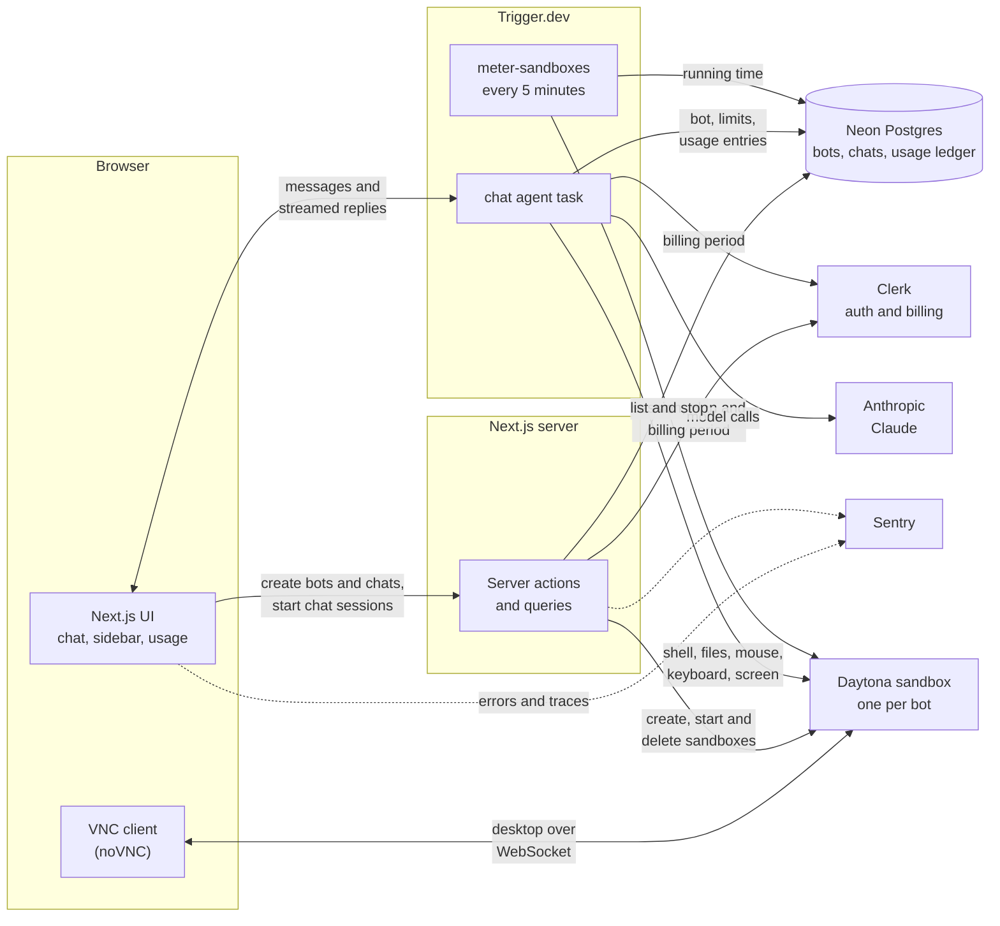

# Genie Bot

AI teammates with their own computers. You create a bot, give it a name, a job and instructions, and chat with it. Every bot gets a private Linux sandbox with a desktop, which it can work in through shell, file, mouse, keyboard and screen tools while you watch live.

## Overview

- **Bots.** Each bot has a face, a name, a job and instructions that shape how it answers.
- **Sandboxes.** A [Daytona](https://www.daytona.io) sandbox is created with every bot and deleted with it. The bot runs commands, reads and writes files, and drives the desktop there.
- **Live desktop.** A resizable panel beside the chat shows the bot's desktop over VNC. Click it to open it fullscreen and take the mouse and keyboard yourself.
- **Group chats.** Put several bots in one chat and pick which one answers each message. Replies are labelled with their author, and each bot knows who else is in the chat.
- **Durable chat.** The chat agent runs on [Trigger.dev](https://trigger.dev), so a reply survives a page reload, and the transcript is stored per chat.
- **Billing and usage.** A paid plan (Clerk Billing) unlocks bots and sandboxes. A usage ledger meters model cost and sandbox time per billing period, enforces the plan's limits, and is shown on a usage page.
- **Monitoring.** Errors and traces are reported to Sentry when a DSN is set.

## Architecture



How a message travels:

1. The browser asks a server action to start a chat session. The action checks the signed-in user owns the chat, is on the paid plan and has usage left, then returns a token scoped to that chat.
2. The browser sends the message straight to the Trigger.dev chat agent and streams the reply back.
3. On each turn the agent loads the chat's bot, builds its system prompt, and calls Claude with the sandbox tools. Tool calls run in that bot's Daytona sandbox.
4. When the turn ends, the agent writes its token cost to the usage ledger. A scheduled task separately adds sandbox running time every five minutes and stops sandboxes whose owner is out of hours.

### Tech stack

| Area | Technology |
| --- | --- |
| Framework | Next.js 16 (App Router), React 19, TypeScript |
| UI | shadcn/ui on Base UI, Tailwind CSS 4, AI Elements |
| Auth and billing | Clerk |
| Database | Neon Postgres with Drizzle ORM |
| Agent runtime | Trigger.dev `chat.agent`, Vercel AI SDK, Anthropic Claude |
| Sandboxes | Daytona, with noVNC for the desktop |
| Monitoring | Sentry |

### Project layout

| Path | What lives there |
| --- | --- |
| `app/` | Routes: the dashboard, chat pages, pricing, usage, sign-in and sign-up |
| `actions/` | Server actions for bots, chats and usage |
| `queries/` | Database reads scoped to the signed-in user |
| `components/` | UI, including `ui/` (shadcn) and `ai-elements/` |
| `trigger/` | The chat agent, its sandbox tools and the usage meter |
| `db/` | Drizzle schema and client |
| `lib/` | Daytona client, billing limits and the usage ledger |

## Getting started

### Prerequisites

- [Bun](https://bun.sh) 1.3 or later, and Node.js 20.9 or later (used by the Trigger.dev CLI).
- Accounts, all with free tiers:
  - [Clerk](https://clerk.com) for sign-in and billing
  - [Neon](https://neon.com) for Postgres
  - [Anthropic](https://console.anthropic.com) for the model
  - [Trigger.dev](https://trigger.dev) for the agent runtime
  - [Daytona](https://app.daytona.io) for sandboxes
- Optional: a [Sentry](https://sentry.io) project.

### 1. Clone and install

```bash
git clone https://github.com/Aneesh-Bhadauria/genie-bot.git
cd genie-bot
bun install
```

### 2. Set the environment variables

Create a file named `.env.local` in the project root:

```bash
# Clerk: dashboard > API keys
NEXT_PUBLIC_CLERK_PUBLISHABLE_KEY=
CLERK_SECRET_KEY=
NEXT_PUBLIC_CLERK_SIGN_IN_URL=/sign-in
NEXT_PUBLIC_CLERK_SIGN_UP_URL=/sign-up
NEXT_PUBLIC_CLERK_SIGN_IN_FALLBACK_REDIRECT_URL=/
NEXT_PUBLIC_CLERK_SIGN_UP_FALLBACK_REDIRECT_URL=/

# Neon: the pooled connection string, and the direct one for schema pushes
DATABASE_URL=
DATABASE_URL_UNPOOLED=

# Anthropic
ANTHROPIC_API_KEY=

# Trigger.dev: project > API keys > the development secret key
TRIGGER_SECRET_KEY=

# Daytona: dashboard > API keys
DAYTONA_API_KEY=
DAYTONA_API_URL=https://app.daytona.io/api

# Sentry (optional): leave unset to turn reporting off
NEXT_PUBLIC_SENTRY_DSN=
```

The file is ignored by git. Never commit it.

### 3. Create the database tables

```bash
bun run db:push
```

### 4. Set up the paid plan in Clerk

Bots and sandboxes are only available on a plan with the slug `pro` that has two features, `bots` and `sandboxes`. In the Clerk dashboard:

1. Open **Billing > Settings** and enable billing for users.
2. Open **Billing > Plans**, create a user plan with the slug `pro`, and add the features `bots` and `sandboxes` to it.

Then sign up in the app and subscribe on the `/pricing` page. A development Clerk instance uses a test payment gateway, so a test card such as `4242 4242 4242 4242` works.

### 5. Point Trigger.dev at your project

Open `trigger.config.ts` and replace the `project` value with the ref of your own Trigger.dev project (it starts with `proj_`).

### 6. Run it

The app needs two processes. In one terminal, start the Trigger.dev worker, which runs the chat agent and the usage meter:

```bash
npx trigger.dev@latest dev
```

In a second terminal, start the app:

```bash
bun dev
```

Open [http://localhost:3000](http://localhost:3000), sign up, subscribe to the plan, and create your first bot.

### Useful scripts

| Command | What it does |
| --- | --- |
| `bun dev` | Start the development server |
| `bun run build` | Build for production |
| `bun run typecheck` | Type-check the project |
| `bun run lint` | Lint the project |
| `bun run format` | Format TypeScript files with Prettier |
| `bun run db:push` | Apply the Drizzle schema to the database |
| `bun run db:studio` | Browse the database in Drizzle Studio |

## Configuration notes

- **Plan limits.** What a billing period includes (model spend, sandbox hours, number of bots) is set in `lib/billing.ts`. Model prices used to cost a turn are in `lib/usage.ts`.
- **Model.** The agent's model is set in `trigger/chat.ts`.
- **Sentry.** `next.config.ts` names the Sentry organization and project that source maps are uploaded to. Change them to your own, and set `SENTRY_AUTH_TOKEN` in your build environment to upload source maps.
- **Production.** The Trigger.dev tasks run in their own environment. It needs `ANTHROPIC_API_KEY`, `DATABASE_URL`, `CLERK_SECRET_KEY`, `DAYTONA_API_KEY` and `DAYTONA_API_URL`, and the tasks have to be deployed with `npx trigger.dev@latest deploy`.

## License

Released under the [MIT License](LICENSE).
